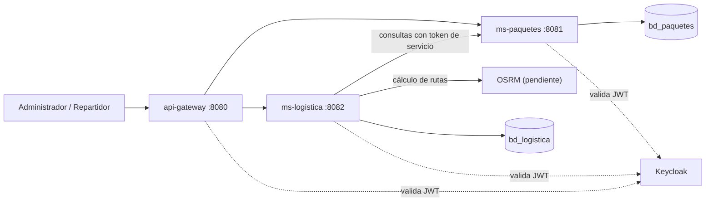

# Sistema de Logística de Paquetes

Backend de una empresa de logística de última milla. Registra paquetes en una sucursal, administra la flota y los repartidores, asigna cargas a vehículos según su capacidad y planifica la ruta de entrega más conveniente con un motor de ruteo (OSRM).

**Trabajo Práctico — Backend de Aplicaciones, UTN FRC (Ingeniería en Sistemas de Información)**

**Integrantes:** _(completar con nombre y apellido de los 4 integrantes)_

---

## Qué resuelve

La planificación manual de entregas genera camiones sobrecargados o subutilizados, rutas que se solapan y recorridos más largos de lo necesario. El sistema automatiza esa planificación:

1. El operador registra los paquetes que llegan a la sucursal.
2. Se agrupan en un envío (mínimo 6 paquetes) y se le asignan un vehículo y un repartidor disponibles, validando el peso y el volumen contra la capacidad del vehículo.
3. Se calcula la ruta óptima que incluye todas las paradas.
4. El repartidor consulta su ruta, inicia el reparto y registra el resultado de cada entrega.

### Alcance del MVP

Incluye: gestión de sucursales, clientes, vehículos, repartidores y paquetes; asignación de recursos con validación de capacidad; planificación de rutas; consulta de ruta y registro del resultado de entrega por el repartidor.

No incluye: seguimiento del paquete por parte del cliente, tracking GPS en tiempo real, cotización de envíos, pagos ni facturación, y clasificación en múltiples sectores (el MVP trabaja con un único sector, `CENTRAL`).

---

## Arquitectura



| Componente | Responsabilidad | Puerto interno |
|---|---|---|
| `api-gateway` | Punto de entrada único. Valida el token y enruta a los microservicios. | 8080 |
| `ms-paquetes` | Sucursales, clientes, vehículos, repartidores y paquetes. | 8081 |
| `ms-logistica` | Envíos, asignaciones, rutas (integración con OSRM) y resultados de entrega. | 8082 |
| `mariadb-db` | MariaDB con las bases lógicas `bd_paquetes`, `bd_logistica` y `bd_keycloak`. | 3306 |
| `keycloak` | Autenticación y autorización (OAuth2 / OIDC, tokens JWT). | 8080 |
| `osrm` | Motor de rutas. **Pendiente**: lo incorpora quien desarrolla `ms-logistica`. | — |

Cada microservicio es dueño de su base y de su lógica. Se comunican por HTTP/REST: `ms-logistica` consulta a `ms-paquetes` con una cuenta de servicio propia, sin pasar por el gateway.

### Tecnologías

| Área | Tecnología |
|---|---|
| Lenguaje y framework | Java 21, Spring Boot 4.1 (Spring Security 7, Spring Data JPA con Hibernate 7) |
| API Gateway | Spring Cloud Gateway (WebFlux) |
| Base de datos | MariaDB 11.8 |
| Identidad | Keycloak 26.4 (JWT, roles de realm) |
| Ruteo | OSRM (HTTP/JSON) |
| Build y ejecución | Maven Wrapper, Docker y Docker Compose |

---

## Estructura del repositorio

```
logistica-paquetes/
├── api-gateway/          Spring Cloud Gateway (reactivo)
├── ms-paquetes/          Microservicio de paquetes y flota
├── ms-logistica/         Microservicio de envíos y rutas
├── infra/
│   ├── keycloak/         realm-logistica.json (se importa solo al arrancar)
│   ├── mariadb/init/     scripts SQL de inicialización
│   └── osrm/             datos y notas de OSRM
├── docs/                 documentación, diagramas y guía de pruebas
├── postman/              colección y entorno de Postman
├── docker-compose.yml            configuración base
├── docker-compose.override.yml   solo desarrollo: publica puertos extra
├── .env.example                  plantilla de variables
└── README.md
```

---

## Requisitos

- **Git**
- **Docker Desktop** (en Windows, con WSL 2 y la virtualización activada en la BIOS)
- **Java 21**: solo si vas a ejecutar un servicio fuera de Docker, desde el IDE
- No hace falta instalar Maven: cada proyecto trae su Maven Wrapper (`mvnw`)

```powershell
git --version
docker --version
docker compose version
java -version
```

---

## Cómo levantar el backend completo

```powershell
# 1. Clonar y entrar a la carpeta
git clone <URL_DEL_REPOSITORIO>
cd logistica-paquetes

# 2. Crear el archivo de variables a partir de la plantilla
Copy-Item .env.example .env
# Abrí .env y completá los valores (ver tabla de variables)

# 3. Construir y levantar todo
docker compose up --build -d

# 4. Verificar
docker compose ps
```

La primera vez tarda varios minutos: se descargan las imágenes y cada servicio descarga sus dependencias de Maven. Keycloak necesita entre 1 y 3 minutos extra para crear sus tablas e importar el realm.

Comprobación rápida (cada uno tiene que responder `{"status":"UP"}`; los puertos 8081 y 8082 solo están publicados en modo desarrollo):

```powershell
curl.exe http://localhost:8080/actuator/health
curl.exe http://localhost:8081/actuator/health
curl.exe http://localhost:8082/actuator/health
```

### Variables de entorno (`.env`)

| Variable | Descripción |
|---|---|
| `MARIADB_ROOT_PASSWORD` | Contraseña del usuario root de MariaDB |
| `DB_USER` | Usuario de base de datos de los servicios. **Debe coincidir con el usuario del script `infra/mariadb/init/01-crear-bases.sql`** |
| `DB_PASSWORD` | Contraseña de ese usuario |
| `KC_ADMIN_USER` | Usuario administrador de la consola de Keycloak |
| `KC_ADMIN_PASSWORD` | Contraseña de ese administrador |
| `MS_PAQUETES_CLIENT_ID` | Client de Keycloak de la cuenta de servicio con la que `ms-logistica` consulta a `ms-paquetes` |
| `MS_PAQUETES_CLIENT_SECRET` | Secreto de ese client |

Las dos últimas deben coincidir con el client definido en `infra/keycloak/realm-logistica.json` (por defecto `ms-logistica` y su secreto de desarrollo). El archivo `.env` **nunca se sube al repositorio**: solo se versiona `.env.example`.

### Modos de ejecución

```powershell
# Desarrollo: usa docker-compose.yml + docker-compose.override.yml
docker compose up --build -d

# Solo el gateway expuesto (ignora el override)
docker compose --file docker-compose.yml up --build -d
```

| Servicio | URL en tu PC | Modo |
|---|---|---|
| API Gateway | http://localhost:8080 | siempre |
| ms-paquetes | http://localhost:8081 | solo desarrollo |
| ms-logistica | http://localhost:8082 | solo desarrollo |
| Keycloak | http://localhost:8180 | solo desarrollo |
| MariaDB | localhost:3307 | solo desarrollo |

### Comandos útiles

```powershell
docker compose ps                         # estado de los contenedores
docker compose logs -f ms-paquetes        # logs de un servicio
docker compose up --build -d ms-paquetes  # reconstruir solo un servicio
docker compose down                       # detener todo (conserva los datos)
docker compose down -v                    # detener y BORRAR volúmenes (bases y realm)
```

> **Importante:** los scripts de `infra/mariadb/init/` y el realm de Keycloak solo se aplican cuando el almacenamiento está vacío. Si cambiás alguno de esos archivos, hay que recrear con `docker compose down -v`.

---

## Seguridad

La autenticación la resuelve **Keycloak** (realm `logistica`). Los tres servicios validan el token JWT. El gateway comprueba que sea auténtico, y cada microservicio exige además el rol de cada endpoint, que lee de `realm_access.roles`.

| Usuario | Contraseña | Rol |
|---|---|---|
| `admin.logistica` | `admin123` | `ADMINISTRADOR` |
| `repartidor.logistica` | `repartidor123` | `REPARTIDOR` |
| _cuenta de servicio_ `ms-logistica` | _client credentials (ver `.env`)_ | `MS_LOGISTICA` |

Son credenciales de desarrollo. La consola de Keycloak está en http://localhost:8180 (usuario y contraseña `KC_ADMIN_*` del `.env`).

La cuenta de servicio permite que `ms-logistica` consulte paquetes, vehículos y repartidores, y actualice el estado de los paquetes, sin necesitar el token de una persona. `ms-logistica` es quien verifica el flujo del repartidor antes de llamar a `ms-paquetes`.

Keycloak fija su URL pública (`http://localhost:8180`) para que el emisor (`iss`) del token sea siempre el mismo, aunque lo pida otro contenedor por la red interna de Docker.

### Obtener un token (PowerShell)

```powershell
function Get-Token($user, $pass) {
  (curl.exe -s -X POST "http://localhost:8180/realms/logistica/protocol/openid-connect/token" `
    -H "Content-Type: application/x-www-form-urlencoded" `
    -d "grant_type=password" -d "client_id=logistica-api" `
    -d "username=$user" -d "password=$pass" | ConvertFrom-Json).access_token
}

$admin = Get-Token "admin.logistica" "admin123"
$rep   = Get-Token "repartidor.logistica" "repartidor123"

curl.exe -i -H "Authorization: Bearer $admin" http://localhost:8080/sucursales
```

Los tokens duran unos 5 minutos. Si aparece un `401` de golpe, hay que pedir uno nuevo.

### Respuestas de seguridad

| Situación | Código |
|---|---|
| Sin token, o token inválido o vencido | `401 Unauthorized` |
| Token válido pero sin el rol requerido | `403 Forbidden` |
| Endpoint sin regla definida (usuario autenticado) | `403 Forbidden` |

**Reglas del equipo para cada endpoint nuevo:**

1. Agregarlo al `SecurityConfig` de su servicio con el rol que corresponde. Lo que no esté listado queda **denegado** (`anyRequest().denyAll()`).
2. Si es un recurso nuevo, agregar su ruta (`Path=...`) en `api-gateway/src/main/resources/application.yml`. Sin eso, el gateway responde `404` aunque el servicio funcione.
3. Probarlo por el gateway (`:8080`) antes de abrir el Pull Request, no solo contra el puerto del servicio.

---

## API

El detalle completo (con la seguridad de cada endpoint) está en `docs/`. Resumen:

### ms-paquetes

| Recurso | Endpoints |
|---|---|
| Sucursales | `POST /sucursales` · `GET /sucursales` · `GET /sucursales/{id}` · `PUT /sucursales/{id}` · `PATCH /sucursales/{id}/desactivacion` |
| Clientes | `POST /clientes` · `GET /clientes` (filtro `?nombre=`) · `GET /clientes/{id}` · `PUT /clientes/{id}` |
| Vehículos | `POST /vehiculos` · `GET /vehiculos` (filtro `?disponible=`) · `GET /vehiculos/{id}` · `PUT /vehiculos/{id}` · `PATCH /vehiculos/{id}/disponibilidad` |
| Repartidores | `POST /repartidores` · `GET /repartidores` (filtro `?disponible=`) · `GET /repartidores/{id}` · `PUT /repartidores/{id}` · `PATCH /repartidores/{id}/disponibilidad` |
| Paquetes | `POST /paquetes` · `GET /paquetes` (filtros `?estado=` y `?sector=`) · `GET /paquetes/{id}` · `PATCH /paquetes/{id}/estado` _(pendiente)_ |

Altas, modificaciones y listados: `ADMINISTRADOR`. Las consultas de paquetes, vehículos y repartidores, y el cambio de estado de un paquete, también las puede hacer la cuenta de servicio `MS_LOGISTICA`.

### ms-logistica _(en desarrollo)_

| Endpoint | Operación | Rol |
|---|---|---|
| `POST /envios` | Crear un envío con paquetes del sector | `ADMINISTRADOR` |
| `GET /envios` | Consultar envíos | `ADMINISTRADOR` |
| `GET /envios/disponibilidad` | Consultar vehículos y repartidores disponibles | `ADMINISTRADOR` |
| `GET /envios/{id}` | Consultar un envío | `ADMINISTRADOR`, `REPARTIDOR` |
| `POST /envios/{id}/asignaciones` | Asignar paquetes, vehículo y repartidor | `ADMINISTRADOR` |
| `POST /envios/{id}/ruta` | Calcular y guardar la ruta del envío | `ADMINISTRADOR` |
| `GET /envios/{id}/ruta` | Consultar la ruta de un envío | `ADMINISTRADOR`, `REPARTIDOR` |
| `GET /envios/mias/rutas` | Consultar las rutas del repartidor autenticado | `REPARTIDOR` |
| `PATCH /envios/{id}/inicio` | Iniciar el reparto | `REPARTIDOR` |
| `PATCH /envios/{id}/paquetes/{paqueteId}/resultado` | Registrar el resultado de una entrega | `REPARTIDOR` |

### Formato de errores

Los errores de negocio y de validación tienen el mismo formato en ambos servicios:

```json
{
  "timestamp": "2026-11-16T15:30:00Z",
  "status": 422,
  "error": "Unprocessable Entity",
  "mensaje": "Ya existe un vehículo con la patente AB123CD",
  "detalles": []
}
```

| Código | Cuándo |
|---|---|
| `400` | Datos inválidos, parámetro con valor inválido o capacidad excedida |
| `401` | Sin token o token inválido (respuesta de Spring Security, sin cuerpo) |
| `403` | Sin el rol necesario (respuesta de Spring Security, sin cuerpo) |
| `404` | Recurso inexistente |
| `422` | Regla de negocio incumplida (recurso no disponible, referencia inexistente, mínimo de paquetes) |
| `503` | Un servicio externo (otro microservicio, Keycloak u OSRM) no responde |

---

## Reglas de negocio principales

**Paquete:** alto, ancho, largo y peso obligatorios y mayores a cero; dirección y coordenadas (latitud y longitud) del destino; el cliente debe existir y la sucursal debe existir y estar activa. El sector lo asigna el sistema (`CENTRAL`) y nace en estado `PENDIENTE`.

**Estados del paquete:** `PENDIENTE`, `ASIGNADO`, `EN_CAMINO`, `ENTREGADO`, `INCIDENCIA`.

**Vehículo:** patente única con formato argentino (`ABC123` o `AB123CD`), peso máximo y volumen máximo obligatorios y mayores a cero, sucursal activa.

**Repartidor:** usuario (`username`) único, vinculado a su cuenta de Keycloak (`preferred_username`).

**Envío:** requiere al menos 6 paquetes `PENDIENTE`; solo se asignan vehículos y repartidores disponibles; el peso y el volumen del lote no pueden superar la capacidad del vehículo (el volumen de un paquete es `alto × ancho × largo / 1.000.000` m³); la ruta debe incluir los destinos de todos los paquetes del envío.

---

## Pruebas

La guía paso a paso (terminal y Postman) está en `docs/GUIA_PRUEBAS_MS_PAQUETES.md`: cómo levantar el entorno desde cero, pedir los tokens, probar cada recurso con los códigos esperados y armar la colección de Postman. Los casos de seguridad que se verifican son:

| Caso | Esperado |
|---|---|
| Administrador registra un paquete | `201` |
| Repartidor intenta registrar un vehículo | `403` |
| Petición sin token | `401` |
| Capacidad del vehículo excedida | error de negocio |
| Envío con menos de 6 paquetes | error de negocio |

---

## Cómo trabajamos en equipo

### Ramas

- **`main`** es la rama estable. Siempre debe levantar con `docker compose up --build -d`. Está protegida: no se sube directo, solo por Pull Request.
- Cada integrante trabaja en su propia rama, creada desde `main` actualizado:

| Rama | Responsable | Carpeta |
|---|---|---|
| `feature/ms-paquetes` | _(nombre)_ | `ms-paquetes/` |
| `feature/ms-logistica` | _(nombre)_ | `ms-logistica/` (y OSRM) |

Para trabajos puntuales: `feature/...`, `fix/...`, `docs/...`, `chore/...`.

```powershell
git checkout main
git pull
git checkout -b feature/nombre-de-la-rama
git branch --show-current          # confirmar la rama antes de escribir código
```

### Flujo diario

```powershell
git add .
git status                         # revisá qué se va a subir
git commit -m "feat(ms-paquetes): alta de vehiculos"
git push
```

Al empezar cada jornada, traé los cambios de `main` a tu rama:

```powershell
git fetch origin
git merge origin/main
```

### Commits y Pull Requests

Formato de commit: `tipo(alcance): descripción en minúsculas`, con tipos `feat`, `fix`, `docs`, `chore` y `test`.

1. Abrí el PR hacia `main` desde GitHub y describí qué hace y cómo probarlo.
2. Otro integrante lo revisa y lo aprueba (no se aprueba el propio PR).
3. Se mergea con **Create a merge commit**.
4. Antes de mergear, el PR tiene que levantar con Docker.

### Reglas para no pisarnos

- Cada uno modifica **solo la carpeta de su servicio**.
- Los archivos compartidos (`docker-compose*.yml`, `.env.example`, `README.md`, `docs/`, y el `application.yml` del gateway) se cambian en PRs chicos y aparte, avisando al resto.
- **Nunca se suben** `.env`, carpetas `target/`, contraseñas reales ni archivos de mapa de OSRM (`*.osm.pbf`).
- Si un merge rompe `main`, se corrige con un PR nuevo o se revierte con `git revert -m 1 <hash>`. No se usa `git push --force` sobre ramas compartidas.

---

## Desarrollo de un servicio fuera de Docker

Para iterar rápido, dejá la infraestructura en Docker y corré solo tu servicio desde la terminal o el IDE:

```powershell
docker compose up -d mariadb-db keycloak
docker compose stop ms-paquetes          # libera el puerto (o ms-logistica)

cd ms-paquetes
$env:DB_USER = "<valor de tu .env>"
$env:DB_PASSWORD = "<valor de tu .env>"
.\mvnw.cmd spring-boot:run
```

Los valores por defecto de cada `application.yml` apuntan a `localhost:3307` (MariaDB) y `localhost:8180` (Keycloak). Mientras corras así, probá **directo contra el puerto del servicio** (`8081` o `8082`): el gateway de Docker enruta a los contenedores, no a tu proceso local. Del mismo modo, un contenedor no puede alcanzar un servicio que corre en tu PC por su nombre (`ms-paquetes`): para probar la integración entre servicios, corran ambos en Docker. Antes de abrir un PR, verificá que funcione dentro de Docker con `docker compose up --build -d <servicio>`.

---

## Convenciones del código

- **Estructura de paquetes** dentro de cada servicio: `config`, `controller`, `domain`, `dto`, `exception`, `repository`, `service`.
- Las **entidades JPA no se exponen en la API**: los controladores reciben y devuelven DTOs.
- **Endpoints en plural** (`/vehiculos`, `/sucursales`). Las acciones de negocio se modelan como sub-recursos (`/envios/{id}/asignaciones`, `/vehiculos/{id}/disponibilidad`).
- Las **reglas de negocio** van en la capa `service`, no en el controlador.
- Cuando el id de otra entidad viaja en el cuerpo de la petición, que no exista es una regla de negocio (`422`), no un `404`.
- **Un solo formato de configuración:** `application.yml` (no `application.properties`).
- El `@Transactional` es el de `org.springframework.transaction.annotation`.

---

## Estado del proyecto

- [x] Estructura del monorepo y Docker Compose
- [x] MariaDB con las bases `bd_paquetes`, `bd_logistica` y `bd_keycloak`
- [x] Keycloak con realm, roles y usuarios de prueba
- [x] Seguridad JWT por rol en gateway y microservicios
- [x] `ms-paquetes`: sucursales, clientes, vehículos, repartidores y paquetes
- [ ] `ms-paquetes`: cambio de estado de un paquete (`PATCH /paquetes/{id}/estado`)
- [ ] Cuenta de servicio `MS_LOGISTICA` en `ms-paquetes` y en el realm
- [ ] `ms-logistica`: envíos, asignaciones y resultados de entrega
- [ ] OSRM en Docker Compose e integración de rutas
- [ ] Colección de Postman con escenarios positivos y negativos
- [ ] Documentación final (secciones 02 a 11 del enunciado)

---

## Problemas frecuentes

| Síntoma | Qué hacer |
|---|---|
| `docker` no se reconoce como comando | Abrir Docker Desktop, esperar a que inicie y abrir una terminal nueva |
| Keycloak no responde al principio | Esperar 1 a 3 minutos y revisar `docker compose logs keycloak` |
| `Access denied` en la base | Verificar que `DB_USER` y `DB_PASSWORD` del `.env` coinciden con lo creado; si cambiaste algo, `docker compose down -v` |
| Los cambios en el realm o en el SQL no se aplican | Solo corren con el almacenamiento vacío: `docker compose down -v` y levantar de nuevo |
| `401` con un token que parecía válido | El token venció (5 minutos): pedir uno nuevo |
| `403` para el administrador en un recurso | Falta la ruta en el `SecurityConfig` del servicio, o responde una imagen vieja: `docker compose up --build -d <servicio>` |
| `404` con campo `requestId` al llamar por el gateway | Falta la ruta del recurso en el `application.yml` del gateway |
| Un error inesperado se ve como `403` | La ruta `/error` también pasa por el `SecurityConfig`: tiene que estar permitida, o el error real queda oculto |
| `Empty reply from server` | El servicio todavía está arrancando o se cayó: `docker compose ps -a` y `docker compose logs --tail 80 <servicio>` |
| `Port 8081 was already in use` al correr un servicio | Detener el contenedor correspondiente con `docker compose stop <servicio>` |
| `503` al crear un envío | `ms-logistica` no alcanza a otro servicio: verificar que `ms-paquetes` y Keycloak estén corriendo en Docker |

---

## Documentación

En la carpeta `docs/`:

- Decisiones de diseño, reglas de negocio y tabla de APIs
- Diagramas: proceso principal (BPMN), contexto y contenedores (C4) y entidad-relación de cada base
- Guía de pruebas de `ms-paquetes` (`GUIA_PRUEBAS_MS_PAQUETES.md`)
