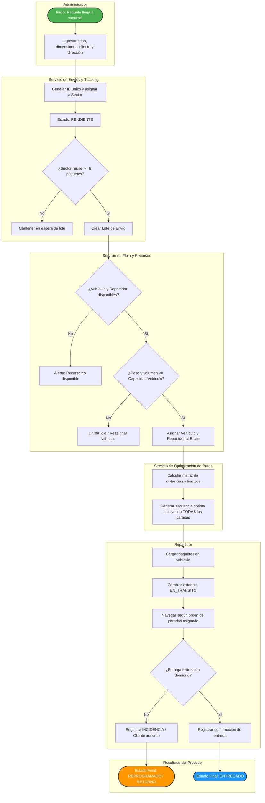
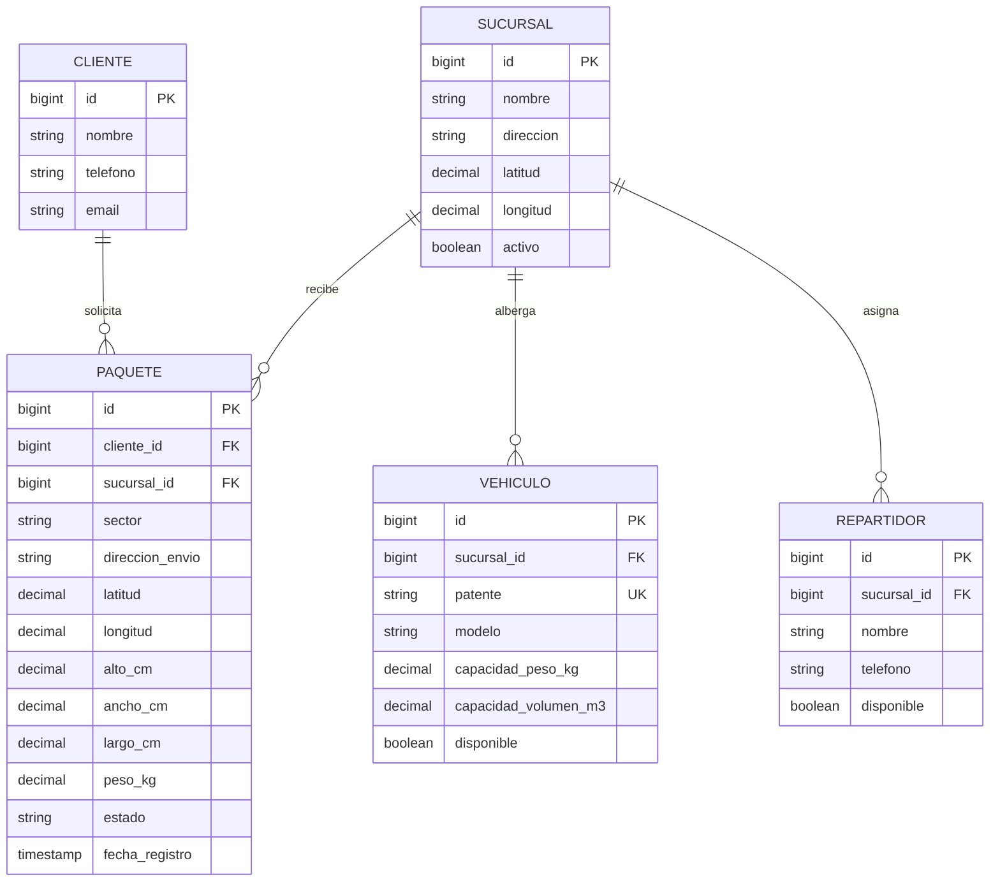
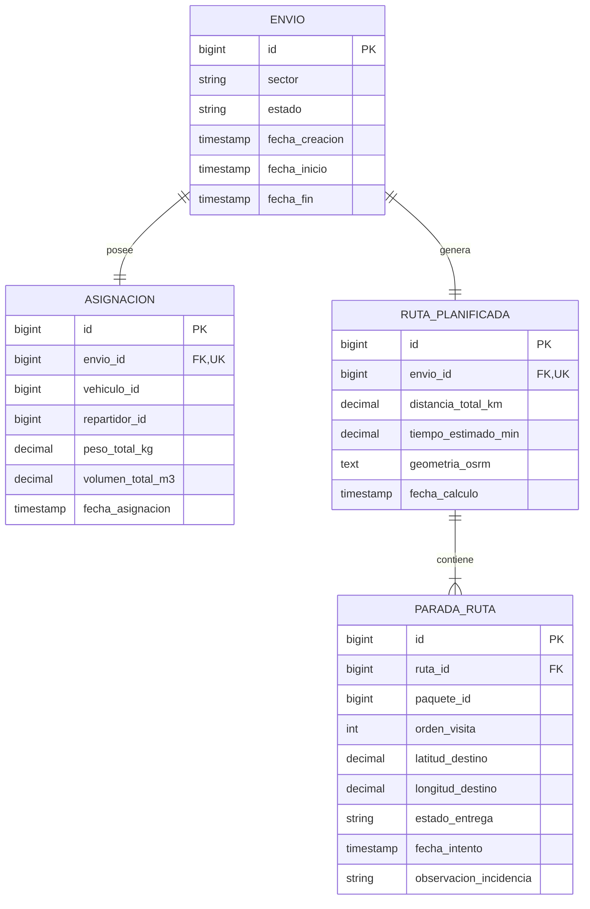

## Diagrama BPMN

1. Recepción y Registro: Llegada de paquete a la sucursal, el administrador ingresa dimensiones, peso, cliente y dirección. El sistema asigna sector y ID.
2. Agrupación y Control de Lote: El paquete queda en estado PENDIENTE. El sistema evalúa si el sector alcanzó la cantidad mínima.
3. Validación de Recursos y Capacidad: Se busca vehículo y repartidor. Se valida que el volumen y peso del lote no excedan la capacidad máxima.
4. Optimización de la Ruta: El motor de cálculo de OSRM toma las direcciones del lote y genera la secuencia óptima de paradas.
5. Viaje y despacho: El repartidor inicia la hoja de ruta. El estado del envío cambia a EN_CAMINO.
6. Ejecución y Registro de Entrega: El repartidor entrega el paquete al cliente o registra la imposibilidad de entrega (ausente/dirección errónea) y queda como pendiente.

## Arquitectura Persistencia

### Diagrama entidad relación de microservicio paquetes

### Diagrama entidad relación de microservicio logística

