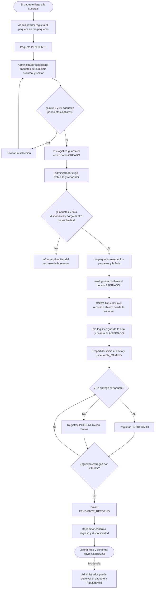
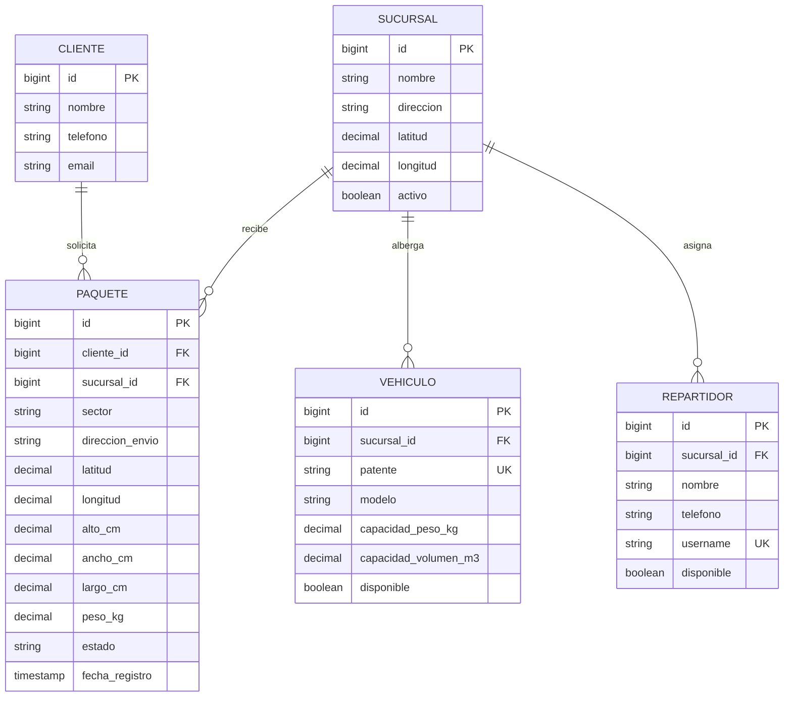
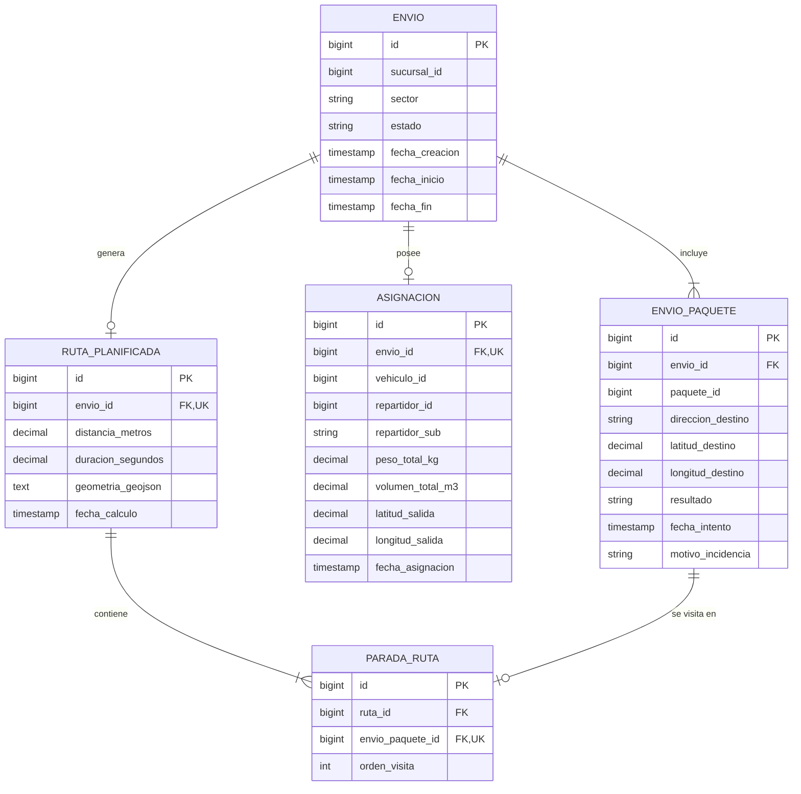

## Diagrama BPMN

1. El administrador registra el paquete en `ms-paquetes` con su sucursal, cliente, dimensiones, peso y destino. El paquete queda `PENDIENTE`.
2. El administrador selecciona entre 6 y 99 paquetes pendientes distintos de la misma sucursal y sector. `ms-logistica` guarda el envío como `CREADO`.
3. El administrador elige vehículo y repartidor. `ms-paquetes` comprueba que sean de la sucursal, estén disponibles y que la carga respete ambos límites del vehículo. Al confirmar la reserva de paquetes y flota, `ms-logistica` pasa el envío a `ASIGNADO`.
4. OSRM Trip recibe las coordenadas de la sucursal y de todos los destinos. Devuelve el recorrido abierto, desde la sucursal hasta la última entrega que elige Trip. `ms-logistica` guarda la ruta y pasa el envío a `PLANIFICADO`.
5. El repartidor asignado inicia el reparto. El envío y sus paquetes pasan a `EN_CAMINO`. Cada intento se registra como `ENTREGADO` o `INCIDENCIA`, con motivo en caso de incidencia.
6. El último intento deja el envío en `PENDIENTE_RETORNO`. Cuando el repartidor confirma que volvió a la sucursal y está disponible, se liberan el vehículo y el repartidor y el envío queda `CERRADO`. El administrador puede reprogramar los paquetes con incidencia de ese envío.

El administrador puede cancelar el envío antes de iniciar el reparto. Si tiene reserva, se libera la flota y los paquetes vuelven a `PENDIENTE`.

## Arquitectura Persistencia

### Diagrama entidad relación de microservicio paquetes

### Diagrama entidad relación de microservicio logística

Modelo previsto para `ms-logistica`. `sucursal_id`, `paquete_id`, `vehiculo_id` y `repartidor_id` son referencias externas a `ms-paquetes`.

